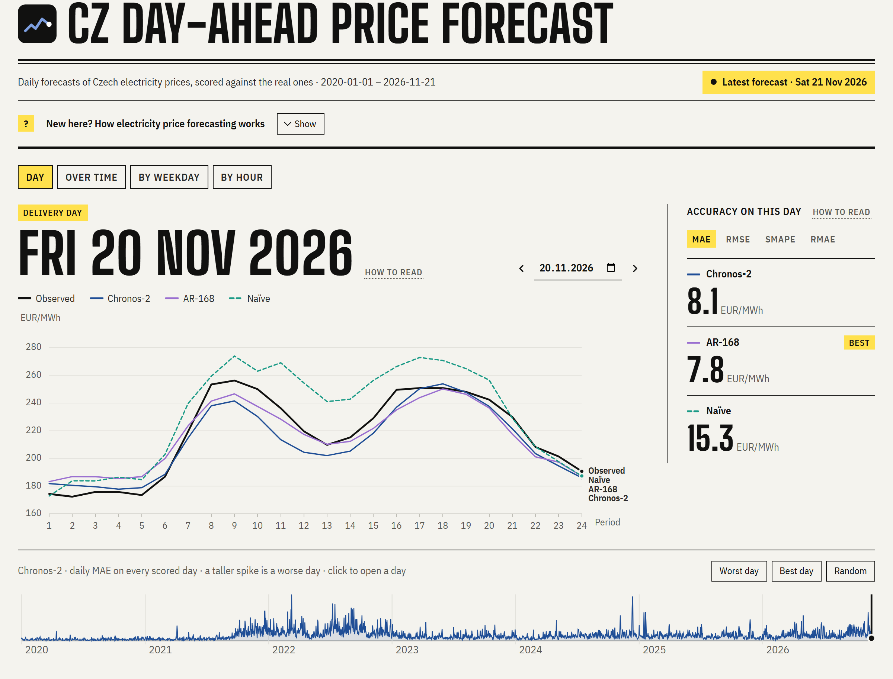
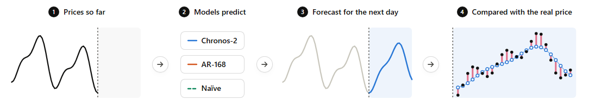

# CZ Day-Ahead Price Forecast

[](https://github.com/Zednicek-Adam/cz-electricity-price-forecast/actions/workflows/main.yml)

A public dashboard that forecasts Czech wholesale electricity prices two days
ahead, then scores each forecast against the price the market actually set.
The project was inspired by the author's master's thesis,
[*Short-term electricity price forecasting*](https://theses.cz/id/kzgw3t/?lang=en)
(Masaryk University, 2026), which compared twelve forecasting models on the
Czech day-ahead market.

**The dashboard:** <https://cz-epf.adam-zednicek123.workers.dev>



## The problem in a minute

Czech electricity, like most of Europe's, is traded the day before it is used.
Every day around noon, an auction called the day-ahead market sets a price for
each hour of the next day. Prices are in euros per megawatt-hour (EUR/MWh).

Those prices are hard to guess. They depend on how much electricity people and
industry use, on how sunny and windy it is, and on the price of gas.

They swing a lot. On a sunny, windy Sunday they can drop below zero. In the
2022 energy crisis they more than doubled.

Anyone who buys, sells or stores electricity wants a good guess at the prices
before the auction. Making that guess is electricity price forecasting.

This project makes the guess every afternoon for the first day whose prices
are not out yet, then scores it once the real prices arrive. With Wednesday as
the day being forecast:


Each daily forecast is made two days before its delivery day, before
any of that day's prices exist.

## How it works



Every afternoon, a GitHub Actions workflow runs these steps:

1. **Fetch the prices.** It downloads the newest prices from the ENTSO-E
   Transparency Platform, where Europe's grid operators publish market data.
2. **Forecast.** Each model forecasts the next day whose prices are not out
   yet.
3. **Save to CSV.** The new prices and forecasts are added to the CSV files in
   `data/` and committed to git.
4. **Export.** The commit triggers a deploy, and a script recomputes every
   figure from the CSV files into one file, `dashboard.json`.
5. **Publish.** Cloudflare serves the dashboard as a static site, which reads
   that file in the browser.

There is no database and no server.

| Directory | What it is |
|---|---|
| `forecast/` | Python: fetching prices, the models, backtests, the daily run, the export |
| `web/` | TypeScript: the dashboard, a static site on Cloudflare |
| `data/` | The two records, observed prices and forecasts, as CSV |
| `docs/` | Reader docs, developer docs and the decision records |

## What the dashboard shows

From top to bottom:

- **The main chart**, in four views:
  - **Day**, pictured above: one day's real price against each model's
    forecast, opening on the newest forecast.
  - **Over time**: each model's accuracy since 2020, or over the last 30 or
    7 days.
  - **By weekday**: which days of the week the models miss most.
  - **By hour**: which hours of the day the models miss most.
- **The price chart** shows the real price over the same days, so a bad
  stretch of forecasts can be read against what the market did.
- **The accuracy table** scores every model on all four metrics, over the
  whole record or the last 30 days.
- **The Diebold–Mariano test** checks, hour by hour, whether one model's
  errors are really smaller than another's or the gap is down to luck.

The four metrics:

- **MAE**, the average miss per hour, in EUR/MWh.
- **RMSE**, also in EUR/MWh, but a large miss counts for more than several
  small ones.
- **SMAPE**, the miss relative to the size of the price, from 0 to 200.
- **rMAE**, a model's MAE divided by the naïve forecast's. Below 1 means the
  model beat "each hour costs what it did yesterday".
  - Not comparable to rMAE in published research or in the thesis, which
    measure against a different naïve.

[Reading the figures](docs/reading-the-figures.md) explains every number and
chart in more detail.

## The models

All three see only the history of Czech day-ahead prices. No weather, no
demand, no gas price.

- **Chronos-2**, the headline model. Amazon's pretrained time-series model,
  used as it comes ("zero-shot"), with no training on this data. This project
  did not build the model. It put it into production and built the system that
  scores it.
- **AR-168**, a classic statistical model: a linear regression on the last 168
  hourly price changes, refitted every day. It is ported from the author's
  master's thesis.
- **Naïve**, yesterday's price for the same hour. It is the yardstick the
  others are measured against.

The record goes back to 2020. Up to 2026-10-13 it is a backtest, forecasts
made after the fact by code that could only see the prices published before
each day it forecast. From 2026-10-14 every forecast is made before its price
exists. Both are scored the same way.

## Run it locally

You need [Node 22+](https://nodejs.org) with
[pnpm](https://pnpm.io/installation), and
[uv](https://docs.astral.sh/uv/getting-started/installation/).

```sh
pnpm install
uv sync --project forecast
uv run --project forecast python -m forecast.export # writes web/public/dashboard.json
pnpm --filter @cz-epf/web dev                       # the dashboard, on Vite
```

The checks, CI, backtests and the daily run are in
[Development](docs/development.md).

## Further reading

- [Reading the figures](docs/reading-the-figures.md): every metric and chart,
  in plain language.
- [The record in detail](docs/the-record.md): a dated snapshot of the results,
  the models, and why the figures can be checked: no peeking at future
  prices, no days left out, every forecast kept in git.
- [Development](docs/development.md): building, testing, CI and the daily run.
- [`data/README.md`](data/README.md): where the prices come from and how they
  are stored.
- [`CONTEXT.md`](CONTEXT.md): the glossary, and the definition of record for
  every term and formula.
- [`docs/adr/`](docs/adr/): why each design decision was made.
- [Provisioning](docs/provisioning.md): the accounts and secrets the project
  needs.

## Data and attribution

Electricity price data sourced from the
[ENTSO-E Transparency Platform](https://transparency.entsoe.eu/). ENTSO-E does
not endorse this project and is not responsible for its content or for any
forecasts derived from the data.

ENTSO-E performs no control on the accuracy, currency or consistency of the
data published on the Transparency Platform, and this project uses it under its
own responsibility (Transparency Platform General Terms and Conditions,
clause 6). The series is the day-ahead price for `BZN|CZ` (Transparency
Regulation article 12.1.d), from delivery day 2018-01-01, committed unaltered
in `data/` with its provenance in `data/NOTICE` and `data/README.md`.

**Maintainer contact:** [Adam Zedníček on GitHub](https://github.com/Zednicek-Adam),
or an issue on this repository.
